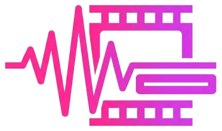

# LocalBachSub

<p align="center">
  
</p>

Công cụ chạy cục bộ trên Windows để **nhận diện lời nói trong video, dịch phụ đề theo ngữ cảnh tự nhiên, chỉnh sửa đối chiếu ngang hàng với video và xuất MP4 có phụ đề**. Giao diện tối giản hỗ trợ chế độ Sáng / Tối, tối ưu cho cả video dọc TikTok / Reels / Shorts lẫn video ngang YouTube.

## Tính năng chính

- **Nhận diện & Nhập phụ đề linh hoạt:** nhận diện giọng nói bằng Whisper (`faster-whisper`) với chế độ ngắt câu gọn chuẩn TikTok, hoặc nhập trực tiếp file `.srt` có sẵn (tự động nhận diện cả **SRT gốc** lẫn **SRT song ngữ**).
- **Dịch tự nhiên liên kết ngữ cảnh:** dịch cục bộ qua Ollama (`qwen3:4b`) giữa tiếng Việt, Anh, Trung, Nhật, Hàn, Pháp và Tây Ban Nha với cửa sổ ngữ cảnh hai chiều giúp câu chữ mượt mà, tự nhiên, tránh dịch máy móc rời rạc; tự động bật ngầm Ollama nếu đang tắt.
- **Biên tập đối chiếu ngang hàng:** trình phát video và bảng chỉnh sửa phụ đề nằm song song ngang tầm mắt ở cả bước biên tập lẫn bước thiết kế khung xuất. Có nút **Gom gọn câu TikTok** giúp nối từ lẻ bị cụt và tách câu dài cân đối.
- **Thiết kế phụ đề chi tiết & Tối ưu TikTok:** 6 bộ màu chọn nhanh, bố cục một chạm cho TikTok `9:16` / `4:5` / `1:1` / `16:9` / khung gốc, hộp nền bo góc ôm khít theo độ rộng chữ thực tế của `libass`, nền rời từng dòng, chỉnh màu viền, đổ bóng, khoảng cách chữ, độ đệm hộp nền, đảo thứ tự dòng song ngữ và đặt chữ vào vùng an toàn TikTok.
- **Xem trực tiếp video trước khi tải:** bấm **Xem thử 30s** hoặc **Xuất & Xem toàn bộ MP4** để phát kiểm tra chuyển động và âm thanh ngay trên trình duyệt rồi mới bấm tải về máy. Xuất đầy đủ `.srt`, `.vtt`, `.ass`, `.zip` và `.mp4`.

## Cài đặt và chạy

**Cần có:** Windows 10/11, Python 3.11 hoặc 3.12 bản 64-bit, [Ollama](https://ollama.com/download/windows), Internet trong lần tải thư viện và mô hình đầu tiên. NVIDIA GPU giúp nhận diện nhanh hơn; máy không có GPU rời có thể chọn **CPU** và mô hình **small**.

1. Tải mã nguồn về máy:

   ```powershell
   git clone https://github.com/bachkhi29/VietSub-Local.git
   cd VietSub-Local
   ```

2. Cài Python từ [python.org](https://www.python.org/downloads/) và cài [Ollama](https://ollama.com/download/windows).
3. Chạy `1_CAI_DAT.bat` một lần để tạo môi trường `.venv`, cài thư viện và tải mô hình dịch `qwen3:4b`.
4. Chạy `2_MO_TOOL.bat`. Giao diện mở tại `http://127.0.0.1:7860` (tự bật ngầm Ollama nếu cần). Giữ cửa sổ Terminal mở trong lúc sử dụng.

## Quy trình sử dụng trong 2 bước

1. **Tab 1 · Dịch & Biên tập đối chiếu:** thả video/âm thanh hoặc file SRT (gốc/song ngữ) vào → bấm **Tạo / Nhập phụ đề**. Khung nạp tự thu gọn để trình phát video và bảng phụ đề nằm ngang hàng. Chọn văn phong dịch rồi bấm **Dịch các câu còn trống**, nhấp đúp ô bất kỳ để sửa hoặc bấm **Gom gọn câu TikTok**.
2. **Tab 2 · Thiết kế chữ & Xem / Xuất Video:** chọn bộ màu nhanh, tỷ lệ khung hình (`9:16` TikTok, `16:9`, giữ khung gốc...), chỉnh độ gọn khối chữ và vị trí. Khung ảnh bên phải tự cập nhật tức thì; bấm **Xem thử 30s** hoặc **Xuất & Xem toàn bộ MP4** để xem video hoàn chỉnh ngay trên giao diện trước khi bấm **Tải về MP4**.

## Lưu trữ dữ liệu

Mọi dự án, phụ đề và video của người dùng nằm trong thư mục `output/<mã công việc>/` trên máy cục bộ và đã được loại trừ trong `.gitignore` (cùng `models/` và `.venv/`). Video gốc không bị ghi đè.

## Kiểm tra tự động

```powershell
.\.venv\Scripts\python.exe -m unittest discover -s tests -v
```

Hướng dẫn cài đặt nhanh dạng trang web nằm trong [BAT_DAU.html](BAT_DAU.html).

## Giấy phép

Mã nguồn dự án phân phối theo [MIT License](LICENSE). Whisper, Ollama, Qwen, FFmpeg và các thư viện đi kèm tuân theo giấy phép riêng của từng dự án.
