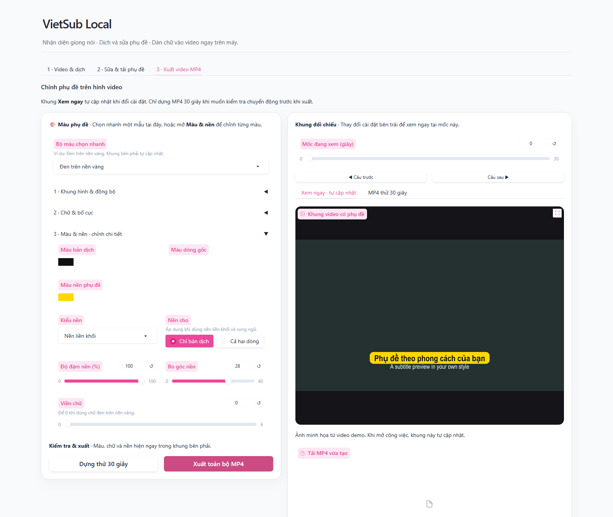

# VietSub Local

Công cụ chạy trên Windows để **nhận diện lời nói trong video, dịch phụ đề, chỉnh sửa và xuất video có phụ đề**. Giao diện tiếng Việt; mô hình nhận diện và dịch chạy trên máy sau khi tải về.



*Ảnh chụp giao diện với video và phụ đề minh họa, không dùng dữ liệu cá nhân.*

## Tool làm được gì?

- Nhận diện lời nói bằng Whisper, hoặc nhập SRT có sẵn để bỏ qua bước nhận diện.
- Dịch giữa các ngôn ngữ được hỗ trợ: Việt, Anh, Trung, Nhật, Hàn, Pháp và Tây Ban Nha. Có thể chọn ngôn ngữ nguồn hoặc để tự nhận diện khi xử lý âm thanh.
- Sửa câu chữ và thời gian phụ đề trước khi xuất.
- Xem ngay một khung video khi đổi font, màu, bố cục và độ trễ; dựng thử MP4 30 giây để kiểm tra chuyển động.
- Xuất SRT, VTT, ASS, ZIP phụ đề và MP4 đã dán chữ. MP4 có thể giữ khung gốc hoặc đổi sang 16:9, 4:3, 1:1, 4:5, 9:16.

## Cài và chạy

**Cần có:** Windows 10/11, Python 3.11 hoặc 3.12 bản 64-bit, [Ollama](https://ollama.com/download/windows), Internet trong lần tải thư viện và mô hình đầu tiên. Cần nhiều GB dung lượng trống cho mô hình và video xuất. NVIDIA GPU giúp nhận diện nhanh hơn; máy không có NVIDIA có thể chọn **CPU** và mô hình **small** trong app.

1. Tải mã bằng nút **Code → Download ZIP** trên GitHub rồi giải nén, hoặc dùng Git:

   ```powershell
   git clone https://github.com/bachkhi29/VietSub-Local.git
   cd VietSub-Local
   ```

2. Cài Python từ [python.org](https://www.python.org/downloads/) và Ollama; mở Ollama.
3. Chạy `1_CAI_DAT.bat`. Script tạo môi trường Python riêng, cài thư viện và tải mô hình dịch `qwen3:4b`. Mô hình Whisper được tải ở lần nhận diện đầu.
4. Chạy `2_MO_TOOL.bat`. Giao diện mở ở `http://127.0.0.1:7860`. Giữ cửa sổ Terminal mở trong lúc dùng tool.

Nếu dùng VS Code: mở thư mục repo, chọn **Terminal → New Terminal**. Trong PowerShell, chạy `.\1_CAI_DAT.bat` một lần; những lần sau chạy `.\2_MO_TOOL.bat`.

## Dùng trong 3 bước

1. **Video & dịch:** tải video/âm thanh lên, chọn ngôn ngữ nguồn và đích. Nếu có SRT nguồn, tải kèm để không phải nhận diện lại. Bấm tạo phụ đề gốc rồi dịch các câu còn trống.
2. **Sửa & tải phụ đề:** rà lại câu chữ, mốc thời gian và tải SRT/VTT/ASS/ZIP. Bản dịch AI có thể sai; nên kiểm tra những câu quan trọng.
3. **Xuất video MP4:** chọn khung hình và cách hiển thị phụ đề. Ô **Bộ màu chọn nhanh** có mẫu **Đen trên nền vàng**; có thể chỉnh màu, font, bố cục và độ trễ. Khung **Xem ngay** tự cập nhật một ảnh tĩnh. Dùng **Dựng thử 30 giây** để kiểm tra âm thanh/chuyển động trước khi xuất toàn bộ.

Thử nhập `examples/thu_phu_de.en.srt` nếu muốn xem luồng chỉnh sửa mà chưa có video.

## File được lưu ở đâu?

Mỗi công việc nằm trong `output/<mã công việc>/`. Thư mục này có nội dung và video của người dùng, **không được đưa lên GitHub**. Repo đã có `.gitignore` để loại trừ `output/`, `models/` và `.venv/`.

File phụ đề gồm bản nguồn, bản dịch, song ngữ và ZIP. MP4 mới nằm trong thư mục `renders/` của công việc; video gốc không bị ghi đè. File ASS trong ZIP dùng kiểu mặc định; các tùy chỉnh font/màu ở tab xuất áp dụng cho MP4.

## Giới hạn hiện tại

- Chỉ có launcher và quy trình cài đặt cho Windows.
- File chỉ có âm thanh tạo được phụ đề nhưng không thể xuất MP4 dán chữ khi không có hình.
- Ô **Xem ngay** là một khung tĩnh, không thay cho video thử 30 giây.
- Chưa tách người nói hoặc xử lý hàng loạt video. Chất lượng phụ đề phụ thuộc âm thanh đầu vào và mô hình; cần rà lại trước khi chia sẻ.
- Tool không yêu cầu API key dịch. Mô hình được tải từ bên ngoài ở lần cài/nhận diện đầu; nội dung dịch được gửi tới Ollama tại `127.0.0.1` trên máy của ông.

## Kiểm tra mã nguồn

```powershell
.\.venv\Scripts\python.exe -m unittest discover -s tests -v
```

Các bài test kiểm tra xử lý phụ đề và xuất video bằng FFmpeg. Chúng không thay thế việc xem lại bản dịch của một video thật.

Hướng dẫn cài có hình thức dễ đọc hơn nằm trong [BAT_DAU.html](BAT_DAU.html). Nếu gặp lỗi hoặc muốn đề xuất tính năng, mở **Issue** trên GitHub và mô tả bước tái hiện; tránh đính kèm video/phụ đề riêng tư.

## Giấy phép

Mã nguồn của dự án dùng [MIT License](LICENSE). Whisper, Ollama, Qwen, FFmpeg và các thư viện khác được tải/cài riêng và tuân theo giấy phép của từng bên.
